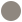

# Bouwinstructie – BellaCampoamor.com

> **Update 10-11-2026:** de site is **puur informatief, zonder artikelen/producten**, en is gebouwd als **één pagina** (statische HTML/CSS/JS, geen Astro). Waar dit document over een collectie of productpagina's spreekt, geldt dat niet meer.

> **Update 10-11-2026 (2):** uitzondering: de HomeDecoBali-collectie wordt getoond (4 willekeurige producten op de homepage, `bali.html` met 4 per categorie), met prijzen en een aanvraagformulier per product. Geen online verkoop. Zie README.

> **Gebruik:** plaats dit bestand als `BUILD_INSTRUCTIONS.md` in de root van een nieuwe, lege GitHub-repo (bijv. `bellacampoamor-site`) en geef Claude de opdracht:
> *"Lees BUILD_INSTRUCTIONS.md en bouw de website volgens deze instructies."*

---

## 1. Doel

Een snelle, moderne en mobielvriendelijke website voor **Bella Furniture & Outdoor**, een winkel in tuin-/buitenmeubelen en interieur in **Dehesa de Campoamor** (Orihuela Costa, Alicante, Spanje).

De site moet:
- de winkel en het assortiment presenteren (buitenmeubelen, loungesets, parasols, interieur, accessoires);
- bezoekers naar de winkel en naar contact (WhatsApp / telefoon / e-mail / formulier) leiden;
- goed vindbaar zijn in Google voor lokale zoekopdrachten (Campoamor, Orihuela Costa, Torrevieja e.o.).

---

## 2. Logo- en merkregels (VERPLICHT)

### 2.1 Bella-logo – alleen bovenaan
- Bestand: `assets/img/bella-logo.png` (wordt meegeleverd; terracotta achtergrond `#D57054`, zwarte letters "BELLA – FURNITURE & OUTDOOR").
- Het Bella-logo verschijnt **uitsluitend in de header (bovenaan elke pagina)**.
- Het logo wordt **nergens anders** gebruikt: niet in de footer, niet in secties, niet als watermerk, niet als achtergrond. Alleen als favicon/Open Graph-afbeelding mag een afgeleide versie gebruikt worden.
- Niet vervormen, niet hertekenen, kleuren niet aanpassen. Breedte in header: ca. 180–240 px desktop, ca. 140–160 px mobiel. Altijd `alt="Bella Furniture & Outdoor"`.
- Het logo linkt naar de homepage.

### 2.2 BellaFlow-beeldmerk – alleen onderaan
- Bestand: `assets/img/bellaflow-mark.svg` (of `.png`) – **wordt later door de eigenaar aangeleverd.** Maak tot die tijd een neutrale placeholder (klein grijs rondje/vierkant) met hetzelfde bestandspad, zodat alleen het bestand vervangen hoeft te worden.
- Het BellaFlow-beeldmerk verschijnt **uitsluitend in de footer, helemaal onderaan**, en nergens anders.
- Direct naast/onder het beeldmerk staat exact de tekst:

  **Powered by Bellaflow.es**

- Beeldmerk + tekst linken samen naar `https://bellaflow.es` (`target="_blank" rel="noopener"`).
- Bescheiden formaat: beeldmerk ca. 20–24 px hoog, tekst klein (13–14 px), gedempte kleur, gecentreerd in een aparte onderste footerregel.

Voorbeeld-markup footerregel:
```html
<div class="powered-by">
  <a href="https://bellaflow.es" target="_blank" rel="noopener">
    
    <span>Powered by Bellaflow.es</span>
  </a>
</div>
```

---

## 3. Huisstijl

| Element | Waarde |
|---|---|
| Primaire kleur (terracotta, uit logo) | `#D57054` |
| Tekst / contrast | `#111111` (zwart, uit logo) |
| Achtergrond | warm off-white `#FAF6F1` |
| Accent licht | zandtint `#EFE4D6` |
| Accent donker | `#8A3F2B` (donkere terracotta voor hovers) |
| Koppen | geometrische, brede sans-serif in hoofdletters (passend bij "BELLA"), bijv. *Archivo Expanded* / *Unbounded* |
| Lopende tekst | rustige sans-serif, bijv. *Inter* of *DM Sans* |

Sfeer: mediterraan, warm, zonnig, rustig en luxe-toegankelijk. Veel witruimte, grote sfeerfoto's van terrassen en buitenruimtes.

Controleer contrast (WCAG AA): witte tekst op `#D57054` is te zwak voor kleine tekst → gebruik zwart of `#8A3F2B` voor kleine tekst op lichte achtergronden.

---

## 4. Techniek

- **Statische site**: [Astro](https://astro.build) (voorkeur) of pure HTML/CSS/JS. Geen zware frameworks.
- Geen database nodig voor versie 1.
- **Hosting:** GitHub Pages via GitHub Actions (workflow `.github/workflows/deploy.yml`), later eigen domein `bellacampoamor.com` via `CNAME`.
- Afbeeldingen: WebP/AVIF, `loading="lazy"`, vaste `width`/`height`.
- Doel Lighthouse: ≥ 90 op Performance, Accessibility, Best Practices en SEO.
- Contactformulier: in v1 een simpele POST naar een **n8n-webhook** (URL als config-variabele `PUBLIC_CONTACT_WEBHOOK` in `.env`, niet hardcoden). Fallback: `mailto:`-link.
- Optioneel later: productcatalogus uit Supabase (niet in v1).

Voorgestelde structuur:
```
/
├─ BUILD_INSTRUCTIONS.md
├─ README.md
├─ public/
│  ├─ assets/img/bella-logo.png
│  ├─ assets/img/bellaflow-mark.svg   (placeholder)
│  ├─ favicon.png
│  └─ CNAME                            (bellacampoamor.com – pas toevoegen bij livegang)
├─ src/
│  ├─ layouts/BaseLayout.astro         (header met Bella-logo, footer met BellaFlow)
│  ├─ components/Header.astro
│  ├─ components/Footer.astro
│  ├─ i18n/ (es.json, en.json, nl.json)
│  └─ pages/ (es = standaard, /en/, /nl/)
└─ .github/workflows/deploy.yml
```

---

## 5. Talen

- **Spaans** (standaard, `/`), **Engels** (`/en/`), **Nederlands** (`/nl/`).
- Taalwisselaar in de header (ES · EN · NL).
- `hreflang`-tags en `lang`-attribuut per pagina.
- Alle teksten in i18n-bestanden, niet hardcoded in componenten.

---

## 6. Pagina's en secties

### Header (op elke pagina)
- Links: **Bella-logo** (enige plek van het logo).
- Rechts: navigatie – Inicio · Colección · Sobre nosotros · Visítenos · Contacto – plus taalwisselaar en een opvallende WhatsApp-knop.
- Mobiel: hamburgermenu. Header sticky, compact bij scrollen.

### Home
1. **Hero** – grote sfeerfoto van een terras, korte kop (bijv. "Outdoor living in Campoamor"), twee knoppen: *Bekijk collectie* en *Bezoek de winkel*.
2. **Categorieën** – tegels: Loungesets, Eetsets, Ligbedden, Parasols & schaduw, Binnenmeubelen, Accessoires & decoratie.
3. **Waarom Bella** – 3–4 USP's (bijv. advies in de winkel, levering in de regio, kwaliteitsmaterialen – **laat de eigenaar de definitieve USP's bevestigen**).
4. **Uitgelichte producten / inspiratie** – fotogalerij.
5. **Bezoek onze winkel** – adres, openingstijden, Google Maps-embed.
6. **Contact-CTA** – WhatsApp, telefoon, e-mail.

### Colección
Overzicht per categorie met foto's en korte beschrijving. Geen webshop in v1; per product/categorie een knop "Vraag info aan" (opent WhatsApp met vooringevulde tekst of het contactformulier).

### Sobre nosotros
Verhaal van de winkel, team, foto van de showroom.

### Visítenos
Adres, routebeschrijving, openingstijden, parkeren, kaart.

### Contacto
Formulier (naam, e-mail, telefoon, bericht, voorkeurstaal, privacy-checkbox) → n8n-webhook. Daarnaast WhatsApp, telefoon, e-mail.

### Juridisch (verplicht in Spanje)
- Aviso legal, Política de privacidad, Política de cookies.
- Cookiebanner alleen nodig als er niet-essentiële cookies/analytics worden gebruikt; gebruik bij voorkeur privacyvriendelijke analytics zonder cookies.

### Footer (op elke pagina)
- Bovenste deel: contactgegevens, openingstijden, korte navigatie, social media-links, juridische links, © jaar Bella Furniture & Outdoor (als tekst, **zonder** Bella-logo).
- Onderste regel: **BellaFlow-beeldmerk + "Powered by Bellaflow.es"** (zie 2.2).

---

## 7. SEO

- Unieke `<title>` en meta-description per pagina en per taal.
- Schema.org `FurnitureStore` / `LocalBusiness` JSON-LD met adres, telefoon, openingstijden, geo-coördinaten.
- `sitemap.xml` en `robots.txt`.
- Open Graph- en Twitter-tags.
- Zoekwoorden o.a.: *muebles de exterior Campoamor, muebles de jardín Orihuela Costa, tuinmeubelen Campoamor, outdoor furniture Orihuela Costa*.

---

## 8. Nog aan te leveren door de eigenaar (placeholders gebruiken)

Gebruik duidelijke placeholders (`[[ADRES]]`, `[[TELEFOON]]` enz.) en verzin **geen** gegevens:

- [ ] BellaFlow-beeldmerk (SVG of PNG met transparante achtergrond)
- [ ] Exact adres, telefoonnummer, WhatsApp-nummer, e-mailadres
- [ ] Openingstijden
- [ ] Social media-links (Instagram, Facebook)
- [ ] Productfoto's en sfeerfoto's (tot die tijd neutrale placeholders, géén stockfoto's van andere merken)
- [ ] Definitieve USP's en tekst "Sobre nosotros"
- [ ] Bedrijfsgegevens voor Aviso legal (bedrijfsnaam, CIF/NIF, adres)
- [ ] n8n-webhook-URL voor het contactformulier

---

## 9. Werkwijze voor Claude

1. Lees dit bestand volledig.
2. Zet het project op (Astro), met header, footer en BaseLayout volgens hoofdstuk 2 en 3.
3. Bouw de pagina's in het Spaans, daarna EN en NL via i18n.
4. Voeg SEO, sitemap en JSON-LD toe.
5. Voeg de GitHub Actions-workflow voor GitHub Pages toe.
6. Controleer:
   - het Bella-logo staat **alleen** in de header;
   - het BellaFlow-beeldmerk staat **alleen** in de footer met de tekst **"Powered by Bellaflow.es"**;
   - de site werkt op mobiel (360 px) en desktop;
   - Lighthouse-scores ≥ 90.
7. Werk op een branch (bijv. `feature/initial-site`), commit in logische stappen en open een pull request naar `main` met een samenvatting en een lijst van resterende placeholders.
